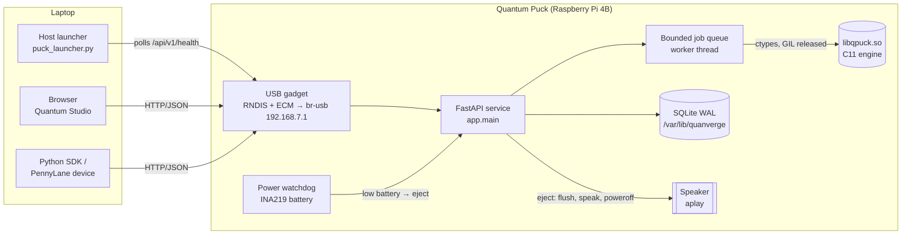

# Architecture

Quantum Puck is a **classical** state-vector simulator of quantum circuits. It runs on ordinary CPUs (a laptop or a
Raspberry Pi 4) and makes no claim of being quantum hardware or of quantum advantage.

## Overview

On the laptop ("virtual Puck") the same API process runs in WSL/Linux/macOS on `localhost:8765`; the battery is
simulated and the eject announcement plays in the browser.

## Components

| Layer | Path | Responsibility |
|---|---|---|
| C engine | `engine/` | Gate library (52 Qiskit standard gates), state-vector kernels, measurement/sampling, validation, OpenQASM 2 import/export, JSON API. No dependencies beyond libc/libm. |
| Python binding | `sdk/python/quanverge_puck/engine.py` | ctypes wrapper; strings in, strings out; cancellation flag; releases the GIL during simulation. |
| API service | `services/api/app/` | FastAPI routes, Pydantic schemas, job manager, SQLite store, auth, device integration (battery, eject, sounds). |
| Studio UI | `apps/studio/` | React + TypeScript + Vite single-page app, prebuilt into `dist/` and served by the API. No runtime Node.js. |
| SDK | `sdk/python/` | Standard-library HTTP client, circuit builder, PennyLane device `quanverge.puck`. |
| Device | `device/` | Pi installer, systemd units, USB gadget, dnsmasq/avahi/polkit config, diagnostics, sounds. |
| Host launcher | `host-launcher/` | Opens Studio on the laptop when the Puck appears (USB or LAN). |

## Request flow (a job)

1. `POST /api/v1/jobs` — Pydantic validates the request shape (types, sizes).
2. `JobManager.submit` calls `qp_validate` in C with the device limits (qubits, shots, ops, depth). Invalid circuits
   are rejected with a structured error **before** anything is queued.
3. The job enters a bounded `queue.Queue` (`queue_size`, default 16). A full queue returns **429**.
4. A worker thread calls `qp_run` with a per-job cancel flag. The engine checks the flag and the timeout
   (`job_timeout_ms`) between operations and every 4096 shots.
5. The result (counts, exact probabilities, optional state vector, depth, timing, seed) is persisted to SQLite and
   returned by `GET /api/v1/jobs/{id}` (long-poll with `?wait=`).

## Engine design

* **State vector**: `double complex[2^n]`, Qiskit little-endian ordering (q0 is the least-significant bit), so
  bitstrings match IBM/Qiskit output.
* **Gates**: each gate is a matrix builder in `gates.c`. Controlled gates are generated from their base matrix;
  `rccx`/`rc3x` are composed from their `qelib1.inc` definitions. Every matrix equals Qiskit's to 1e-12,
  including global phase (`tests/golden/gates.json`).
* **Kernels**: 1-qubit block loops; k-qubit gates enumerate the 2^(n-k) sub-blocks by bit insertion; diagonal gates
  touch only non-unit entries; permutation gates (X, CX, SWAP, Toffoli, C3X, C4X, DCX) only move amplitudes.
* **Measurement**: if all measurements are terminal, the state is simulated once and shots are sampled from the
  cumulative distribution (exact probabilities reported). Mid-circuit measurement or `reset` switches to per-shot
  simulation from the last unitary prefix (probabilities are then estimated from shots).
* **RNG**: xoshiro256** seeded through splitmix64; the seed is always reported, so any run can be reproduced.
* **Limits**: compile-time ceiling `QP_MAX_QUBITS=24`; runtime limits come from the caller (8 by default).
  Large outputs are capped (`max_outcomes`, `max_statevector_qubits`).

## Security model

* Laptop profile binds to `127.0.0.1` only.
* Pi profile binds `0.0.0.0:80`, trusts loopback and the USB link (`192.168.7.0/24`), and requires
  `Authorization: Bearer <token>` from every other network. The token is generated at install time into
  `/etc/quanverge/puck.env` (mode 640) and is never read from the TOML config or logged.
* Circuits are data, not code: there is no `eval`, no file access, and no shell access from requests. The service
  runs as the unprivileged `quanverge` user under systemd sandboxing (`ProtectSystem=strict`,
  `NoNewPrivileges`, only `CAP_NET_BIND_SERVICE`); power-off is granted through a narrow polkit rule.
* Request bodies are limited (1 MB), queue and per-job resources are bounded, errors never include stack traces.

## Data

SQLite (`puck.sqlite3`, WAL mode) holds `jobs` and `experiments`. Jobs left `queued`/`running` by a crash or power
loss are marked `failed` with code `INTERRUPTED` at the next start. Eject checkpoints the WAL and calls `sync`.
