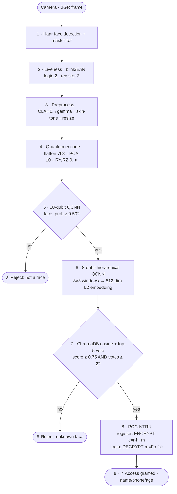

# 🎬 README for Video Generation — Quantum Face Recognition (V1, `main.py`)

A **step-by-step video storyboard** for the V1 pipeline in
[`main.py`](main.py): from **Haar face detection → liveness → quantum recognition →
Post-Quantum NTRU encryption**.

Each scene below gives you:
- **What happens** (the real working mechanism, with the actual numbers from the code)
- **On-screen / data-viz** (what the viewer literally sees)
- **🎬 16:9** and **📱 9:16** video-generation prompts (tool-agnostic — works in Sora, Veo,
  Runway, Kling, Pika, Higgsfield, etc.)
- **🎙️ Narration** (one spoken line per step)

> **Style:** cinematic realistic — a real actor in a quantum lab, with holographic AR
> overlays visualizing each quantum step. Read the **Global Style Guide** once before
> generating, then keep it consistent across all clips.

---

## 1. Overview

The system authenticates a person by their face, then protects their personal data with
**post-quantum cryptography**. It runs two flows on the same pipeline:

- **REGISTRATION** — capture 3 face photos, build a quantum embedding, store it, and
  **encrypt** the user's metadata (name / phone / age) with NTRU.
- **LOGIN** — capture a live face, build the embedding, match it in the vector database, and
  **decrypt** that user's metadata to greet them.

The clever security split: the **face embeddings stay unencrypted** in the vector database
(so search is fast), while only the **personal metadata is encrypted** with NTRU — a cipher
that even a future quantum computer can't break.

---

## 2. Master Workflow Diagram

### ASCII flow
```
                         ┌──────────────────────────────────────────────┐
                         │              CAMERA  (BGR frame)             │
                         └───────────────────────┬──────────────────────┘
                                                 ▼
                    ┌───────────────────────────────────────────────┐
            (1)     │  HAAR FACE DETECTION  + mask filter           │
                    │  haarcascade_frontalface_default.xml          │
                    └───────────────────────┬───────────────────────┘
                                            ▼
            (2)     ┌───────────────────────────────────────────────┐
                    │  LIVENESS  (blink / Eye-Aspect-Ratio)         │  login=2 blinks
                    │  reject photos & spoofs                       │  register=3 blinks
                    └───────────────────────┬───────────────────────┘
                                            ▼
            (3)     ┌───────────────────────────────────────────────┐
                    │  PREPROCESS  CLAHE → gamma 1.2 → skin-tone    │
                    │  resize 16×16 (classify) / 64×64 (recognize)  │
                    └───────────────────────┬───────────────────────┘
                                            ▼
            (4)     ┌───────────────────────────────────────────────┐
                    │  QUANTUM ENCODE  flatten 768 → PCA 10         │
                    │  → RY/RZ angles in [0, π]                     │
                    └───────────────────────┬───────────────────────┘
                                            ▼
            (5)     ┌───────────────────────────────────────────────┐
                    │  10-QUBIT QCNN  face / non-face GATE          │
                    │  face_prob ≥ 0.50 ?  ──no──►  ✗ REJECT        │
                    └───────────────────────┬───────────────────────┘
                                          yes ▼
            (6)     ┌───────────────────────────────────────────────┐
                    │  8-QUBIT HIERARCHICAL QCNN  (Haar wavelet)    │
                    │  64×64 → 8×8 windows → 512-dim embedding (L2) │
                    └───────────────────────┬───────────────────────┘
                                            ▼
            (7)     ┌───────────────────────────────────────────────┐
                    │  CHROMADB SEARCH  cosine, top-5 voting        │
                    │  score ≥ 0.75 AND votes ≥ 2 ? ──no──► ✗       │
                    └───────────────────────┬───────────────────────┘
                                          yes ▼
            (8)     ┌───────────────────────────────────────────────┐
                    │  PQC-NTRU   (N=509, p=3, q=2048)              │
                    │  register: c = r·h + m   (ENCRYPT metadata)   │
                    │  login:    m = Fp·(f·c)  (DECRYPT metadata)   │
                    └───────────────────────┬───────────────────────┘
                                            ▼
            (9)     ┌───────────────────────────────────────────────┐
                    │  RESULT  ✓ Access granted — name / phone / age│
                    └───────────────────────────────────────────────┘
```

### Mermaid


---

## 3. Global Style Guide  *(read once, reuse for every clip)*

| Element | Direction |
|---|---|
| **Protagonist** | "Aria", a focused researcher (late 20s), same wardrobe (charcoal jacket) in every clip for continuity. |
| **Setting** | A dark, modern quantum-computing lab; large monitors; a glass-walled dilution-fridge in the background. |
| **Palette** | Near-black background `#0a0a0f`, **crimson `#de2b47`** primary glow, **cyan `#28e0ff`** secondary accents, white text. |
| **Quantum motifs** | Floating qubits as glowing spheres / mini Bloch spheres; light-trails for data flow; a holographic face wireframe; for PQC, a **glowing 3-D polynomial lattice / padlock**. |
| **Camera language** | Slow push-ins, shallow depth of field, gentle parallax on holograms, 24 fps filmic motion blur. |
| **Typography** | Thin geometric sans for HUD labels (e.g. Outfit); monospace for numbers/angles. |
| **Pace / music** | Calm, precise; low cinematic synth pulse that rises into the PQC + result scenes. |
| **Tool-agnostic phrasing** | Describe *subject, setting, lighting, overlay, motion, lens, mood*. Avoid tool-specific tokens. |
| **Negative prompt (append to each)** | `no text artifacts, no distorted faces, no extra fingers, no warped UI text, no logos, no watermark, no flicker` |

**Continuity tips:** keep Aria's framing and the crimson/cyan grade identical across scenes;
reuse the same HUD font; let each scene's hologram "hand off" to the next (data light-trail
flying out of frame → into the next clip).

---

## 4. Scenes

### Scene 0 — Title / System Intro
**What happens:** Brand open establishing the theme: quantum face recognition secured by
post-quantum cryptography.
**On-screen:** Title lockup "QUANTUM FACE RECOGNITION" with subtitle "Secured by Post-Quantum
NTRU"; a face wireframe forms from particles; qubits orbit.
**🎬 16:9:** "Cinematic title sequence in a dark quantum lab: thousands of glowing crimson and
cyan particles swirl and assemble into a translucent 3-D human face wireframe, soft volumetric
light, slow dolly-in, photoreal, filmic 24fps, shallow depth of field; elegant thin sans-serif
title text fades in centered."
**📱 9:16:** "Vertical hero shot: glowing particles assemble into a 3-D face wireframe centered
in frame, crimson-cyan volumetric light on near-black, slow push-in, title text in the upper
third, lots of negative space, photoreal cinematic."
**🎙️ Narration:** "Your face is your key — and quantum cryptography keeps it safe."

---

### Scene 1 — Camera Capture + Haar Face Detection  *(`src/face_detection.py :: detect_and_filter`)*
**What happens:** A live webcam frame (~640×480 BGR) is scanned by an OpenCV **Haar cascade**
(`haarcascade_frontalface_default.xml`, scaleFactor 1.1, minNeighbors 5, min 30×30). Detected
faces are **filtered to reject masks** by checking texture variance in the lower 40% of the
face, leaving one clean face box.
**On-screen:** webcam feed; a crimson rectangle with corner brackets snaps onto the face; a
thin scan-line sweeps; label "FACE LOCKED". A masked face shows a red "REJECTED".
**🎬 16:9:** "Cinematic medium shot of Aria seated before a glowing monitor in a dark lab lit by
crimson and cyan; a translucent holographic rectangle with corner brackets locks onto her face
with a soft top-to-bottom scan-line sweep, subtle HUD ticks and a small 'FACE LOCKED' label,
shallow depth of field, photoreal, 24fps, slow push-in."
**📱 9:16:** "Vertical close-up of Aria's face centered; crimson holographic face-tracking
brackets snap on with a scan sweep and 'FACE LOCKED' tag, dark lab bokeh behind, photoreal
cinematic lighting, top and bottom kept clear for captions."
**🎙️ Narration:** "It starts with a glance — a Haar cascade finds your face in real time, and
quietly rejects masks."

---

### Scene 2 — Liveness Detection (Blink / Eye-Aspect-Ratio)  *(`src/liveness_detection.py`)*
**What happens:** To stop photo/screen spoofs, the system tracks the eyes and measures the
**Eye-Aspect-Ratio (EAR)** (dlib 68-point landmarks, with a Haar eye-cascade fallback). A blink
is an EAR dip below threshold then recovery. The user must blink **2 times to log in** (and **3
times during registration**, one capture per blink).
**On-screen:** two cyan reticles over the eyes; a live EAR waveform; a blink counter "BLINKS
1/2 → 2/2"; on a blink, a soft shutter flash captures the frame.
**🎬 16:9:** "Cinematic close-up of Aria's eyes in a dark lab, two glowing cyan reticles tracking
each eye, a small holographic waveform plotting her eye-aspect-ratio; she blinks and the
waveform dips then recovers as a crimson counter ticks '1/2' then '2/2', a soft camera-shutter
flash on capture, photoreal, shallow depth of field, 24fps."
**📱 9:16:** "Vertical extreme close-up of Aria's eyes centered, cyan eye-tracking reticles and a
compact EAR waveform overlay, a blink triggers a shutter flash and a '2/2' counter, dark
cinematic bokeh, caption-safe top and bottom."
**🎙️ Narration:** "Then you blink — proof you're a living person, not a photograph."

---

### Scene 3 — Preprocessing (CLAHE → Gamma → Skin-Tone → Resize)  *(`src/preprocessing.py`)*
**What happens:** The cropped face is normalized so lighting and skin tone don't fool the model:
**CLAHE** contrast equalization (clip 2.0, 8×8 tiles), **gamma** correction (1.2), and **YCrCb
skin-tone** normalization, then resized to **16×16** (for the classifier) and **64×64** (for the
embedder) and scaled to [0, 1].
**On-screen:** the face passes through three labeled holographic "filter panes" (CONTRAST →
GAMMA → SKIN-TONE), then snaps into a clean pixel grid; tiny "16×16" and "64×64" tags.
**🎬 16:9:** "Cinematic shot: a floating holographic portrait of Aria's face passes left-to-right
through three translucent glass filter panels labeled 'CLAHE', 'GAMMA', 'SKIN-TONE', each pass
visibly evening out the lighting; the cleaned face then crystallizes into a glowing pixel grid,
crimson-cyan accents on near-black, photoreal, slow lateral dolly, 24fps."
**📱 9:16:** "Vertical stack: Aria's holographic face descends through three glowing filter
panes (CLAHE, GAMMA, SKIN-TONE) one above the next, emerging as a clean pixel grid, crimson-cyan
on black, cinematic, caption-safe edges."
**🎙️ Narration:** "Lighting, brightness and skin tone are balanced — so the quantum model sees
only you, not the room."

---

### Scene 4 — Quantum Encoding (PCA → Rotation Angles)  *(`src/quantum_encoding.py`)*
**What happens:** The 16×16×3 image is flattened to **768 numbers**, compressed by **PCA to 10
features**, standardized, and mapped into **rotation angles in [0, π]** that will drive **RY/RZ**
quantum gates — turning a picture into instructions for qubits.
**On-screen:** 768 dots collapse into 10 bright nodes; each node spins a dial showing an angle
(e.g. "1.84 rad"); 10 qubits light up ready to receive them.
**🎬 16:9:** "Cinematic macro shot: a dense cloud of ~768 tiny glowing data points funnels and
compresses into 10 bright crimson nodes; each node emits a rotating angular dial labeled in
radians; in the background ten translucent qubit spheres pulse, waiting; near-black scene with
cyan rim light, photoreal, slow push-in, 24fps."
**📱 9:16:** "Vertical funnel: a tall column of glowing data points compresses downward into 10
bright nodes with spinning radian dials, ten qubit spheres glowing below, crimson-cyan on black,
cinematic, caption-safe top and bottom."
**🎙️ Narration:** "Your face becomes math — compressed to ten numbers, then to angles a quantum
circuit can read."

---

### Scene 5 — 10-Qubit QCNN: Face / Non-Face Gate  *(`src/qcnn_architecture.py`)*
**What happens:** A **10-qubit Quantum Convolutional Neural Network** (25 trained parameters,
with IsingYY/IsingZZ, CNOT and CRX entangling gates) decides **face vs non-face**. If
`face_prob < 0.50`, the login is **rejected** before any identity is checked.
**On-screen:** 10 qubits encode the angles, entangling links flash between them, the circuit
"pools" down to a single measured qubit; a gauge swings to "FACE 0.97 ✓" (or "NON-FACE ✗").
**🎬 16:9:** "Cinematic shot inside a holographic quantum circuit: ten glowing qubit spheres in a
row receive rotation angles, then crackling crimson entanglement beams connect them in pairs;
the lattice folds and pools toward a single bright qubit that resolves a gauge reading
'FACE — 0.97', confirmation pulse, near-black with cyan accents, photoreal, slow orbit, 24fps."
**📱 9:16:** "Vertical quantum circuit: a column of ten qubit spheres linked by glowing
entanglement beams collapses to one measured qubit showing 'FACE 0.97 ✓', crimson-cyan on black,
cinematic orbit, caption-safe edges."
**🎙️ Narration:** "A ten-qubit quantum network first asks the simplest question — is this even a
face?"

---

### Scene 6 — 8-Qubit Hierarchical QCNN: Face Embedding  *(`src/qcnn_recognition.py`)*
**What happens:** The 64×64 face is split into **8×8 windows**; each window is processed by an
**8-qubit hierarchical QCNN** (Haar-wavelet features, conv→pool layers) that outputs **8 Pauli-Z
measurements**. Stacking them yields a **512-dimensional embedding** (legacy mode: 1536-dim),
then **L2-normalized** into a unique "quantum fingerprint".
**On-screen:** a grid of 8×8 tiles lifts off the face; each tile flows through a small quantum
circuit and drops 8 glowing values into a long bar; the bar coils into a radiant 512-point
signature ring.
**🎬 16:9:** "Cinematic shot: Aria's holographic face fragments into a neat grid of small tiles;
the tiles stream one by one through a compact glowing quantum circuit, each emitting eight light
beads that thread into a long luminous ribbon; the ribbon coils into a radiant circular
'fingerprint' of hundreds of points, crimson-cyan on near-black, photoreal, elegant slow motion,
24fps."
**📱 9:16:** "Vertical: a face-tile grid streams downward through a glowing quantum circuit,
emitting beads that weave into a tall luminous ribbon, which curls into a circular quantum
fingerprint, crimson-cyan on black, cinematic, caption-safe."
**🎙️ Narration:** "Then eight qubits turn your face into a 512-number quantum fingerprint —
yours alone."

---

### Scene 7 — ChromaDB Vector Search + Voting  *(`src/recognition.py`)*
**What happens:** The fingerprint is matched against the **ChromaDB** vector store by **cosine
similarity**. The **top-5** nearest entries "vote"; a person is accepted only if the best
**score ≥ 0.75 AND votes ≥ 2**, which suppresses false matches.
**On-screen:** the fingerprint shoots into a star-field of stored signatures; beams connect to
the 5 nearest; a tally "VOTES 3/5 · SCORE 0.93" lands on one identity card.
**🎬 16:9:** "Cinematic shot: the glowing quantum fingerprint launches into a vast 3-D star-field
of stored signature points; crimson beams snap to the five closest stars; a holographic tally
reads 'VOTES 3/5 · SCORE 0.93' and a single identity card illuminates and locks in, near-black
space with cyan depth haze, photoreal, slow push-in, 24fps."
**📱 9:16:** "Vertical: the fingerprint flies up into a star-field of stored faces, beams to the
5 nearest, a 'VOTES 3/5 · SCORE 0.93' tally resolves onto one glowing identity card, crimson-cyan
on black, cinematic, caption-safe."
**🎙️ Narration:** "Your fingerprint is matched in a quantum vector database — five neighbors vote,
and only a confident match passes."

---

### Scene 8 — PQC-NTRU: Quantum-Safe Encryption / Decryption  *(`PQC/ntru/*`, `PQC/metadata_storage.py`)*
**What happens:** Personal **metadata (name / phone / age)** is protected with **Pure NTRU
post-quantum encryption** (lattice-based, `N=509, p=3, q=2048`, no AES). On **registration** the
data is encoded to ternary and encrypted: `c = r·h + m (mod q)`. On **login**, after a match, the
holder of the private key decrypts it: `m = Fp·(f·c)`. The face embeddings stay searchable; only
the personal data is sealed — and even a quantum computer (Shor's algorithm) can't break the
underlying lattice problem.
**On-screen:** name/phone/age text dissolves into a glowing **polynomial lattice** sealed inside
a crimson padlock (encrypt); on login the lattice unfolds back into clean readable text
(decrypt); a badge reads "POST-QUANTUM SECURE · NTRU N=509".
**🎬 16:9:** "Cinematic shot: a holographic card showing 'Name / Phone / Age' shatters into a
dense 3-D lattice of glowing polynomial nodes that fold into a rotating crimson padlock sealed
with light; a small badge reads 'POST-QUANTUM · NTRU N=509'; then the padlock reverses, the
lattice unfolds back into crisp readable text — encrypt then decrypt — near-black with cyan
accents, photoreal, dramatic slow rotation, 24fps."
**📱 9:16:** "Vertical: a personal-data card collapses into a tall glowing polynomial lattice that
locks into a crimson padlock badged 'NTRU N=509', then unfolds back into readable text on login,
crimson-cyan on black, cinematic, caption-safe top and bottom."
**🎙️ Narration:** "Your details are sealed with NTRU — post-quantum encryption that even a future
quantum computer can't crack — and only unlocked when your face checks out."

---

### Scene 9 — Result: Access Granted
**What happens:** All gates passed — the user is recognized and their decrypted profile is shown.
**On-screen:** a large crimson check; "ACCESS GRANTED"; an identity panel with the now-decrypted
Name / Phone / Age; subtle confetti of qubits.
**🎬 16:9:** "Cinematic hero shot: Aria looks up as a large translucent crimson check-mark forms
with an 'ACCESS GRANTED' headline and a clean identity panel showing her decrypted name, phone
and age; soft qubit sparkles drift past, warm key light returns to her face, photoreal, gentle
push-in, triumphant calm mood, 24fps."
**📱 9:16:** "Vertical: a glowing 'ACCESS GRANTED' check fills the upper frame above Aria's lit
face and a compact decrypted identity panel, qubit sparkles, crimson-cyan on black, cinematic,
caption-safe."
**🎙️ Narration:** "Recognized, verified, and protected — welcome back."

---

## 5. Assembly Notes

**Recommended order:** Scene 0 → 1 → 2 → 3 → 4 → 5 → 6 → 7 → 8 → 9.

**Transitions:** end each clip with a light-trail or hologram element exiting frame, and start
the next with that element arriving — so the data appears to "flow" through the pipeline.

**Runtime targets:**
- **Landscape (16:9):** ~90–120s full explainer (≈10–12s per scene).
- **Vertical (9:16) reel:** ~30–45s — use Scenes 1, 5, 6, 8, 9 only, faster cuts, on-screen captions.

**Audio:** one continuous low cinematic synth pulse; lift the intensity at Scene 8 (PQC) and
resolve warmly at Scene 9. Add subtle UI ticks on each HUD label.

**Captions:** burn in the narration as captions for the vertical cut (keep within the
caption-safe top/bottom zones noted in each 9:16 prompt).

### Shot-list recap
| # | Scene | Maps to | Hero visual |
|---|---|---|---|
| 0 | Title / intro | — | Particles → face wireframe |
| 1 | Haar detection | `face_detection.py` | Crimson face-lock brackets |
| 2 | Liveness / blink | `liveness_detection.py` | Eye reticles + EAR waveform |
| 3 | Preprocessing | `preprocessing.py` | Face through 3 filter panes |
| 4 | Quantum encoding | `quantum_encoding.py` | 768 → 10 nodes → angle dials |
| 5 | 10-qubit classify | `qcnn_architecture.py` | Entangled qubit row → "FACE 0.97" |
| 6 | 8-qubit embedding | `qcnn_recognition.py` | Tiles → 512-point fingerprint ring |
| 7 | ChromaDB search | `recognition.py` | Star-field match + vote tally |
| 8 | PQC-NTRU | `PQC/ntru/*` | Data → lattice → padlock (lock/unlock) |
| 9 | Result | `main.py` | "ACCESS GRANTED" + decrypted profile |

---

## 6. Technical reference (keep prompts accurate)

| Stage | Hard facts |
|---|---|
| Haar detection | `haarcascade_frontalface_default.xml`, scale 1.1, minNeighbors 5; mask filter on lower-40% variance |
| Liveness | Eye-Aspect-Ratio blink; **login 2 blinks · registration 3** |
| Preprocess | CLAHE (2.0, 8×8) → gamma 1.2 → YCrCb skin-tone → 16×16 (classify) / 64×64 (recognize) → [0,1] |
| Encode | flatten 768 → PCA 10 → StandardScaler → RY/RZ angles in [0, π] |
| Classify QCNN | **10 qubits**, 25 params; IsingYY/ZZ, CNOT, CRX; gate **face_prob ≥ 0.50** |
| Embed QCNN | **8-qubit hierarchical**, 34 params; 8×8 windows → 8 Pauli-Z; **512-dim** (1536 legacy); L2-normalized |
| Search | ChromaDB cosine, top-5 voting, **score ≥ 0.75 & votes ≥ 2** |
| PQC | **Pure NTRU v4 (no AES)**, **N=509, p=3, q=2048**, base-3 ternary (~84 B/poly); `c=r·h+m (mod q)` / `m=Fp·(f·c)`; keys in `PQC/keys/`; metadata ciphertext in `PQC/encrypted_metadata/`; **embeddings stay unencrypted in ChromaDB** |

> Note: embeddings are **512-dim** in the default "optimized" mode and **1536-dim** in legacy mode
> (`src/qcnn_recognition.py`). The narration says "512" — change to "1536" if you ship legacy mode.
